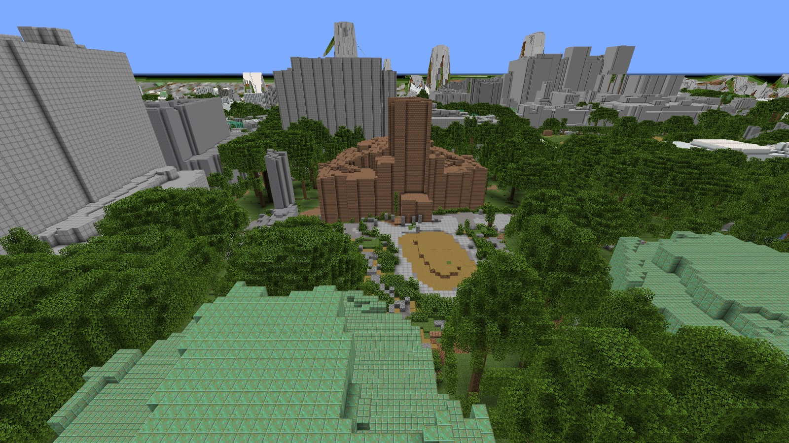
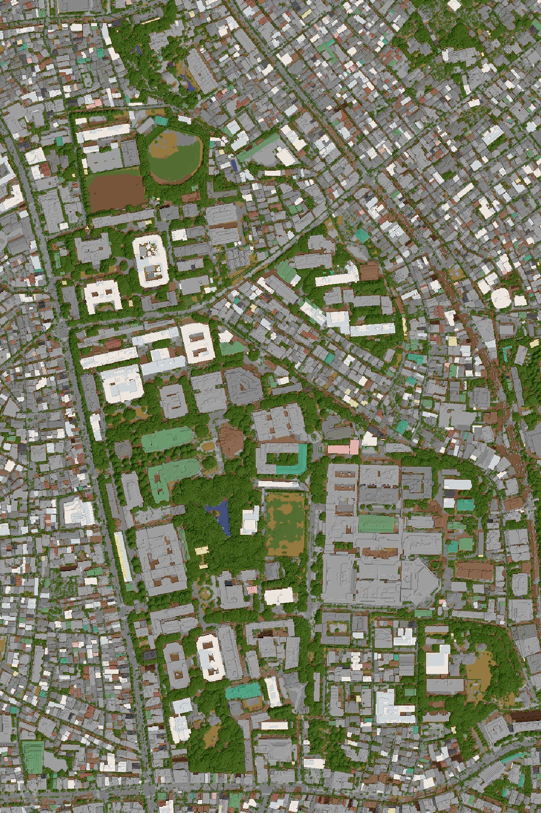

# 本郷キャンパス Minecraft ワールド / Hongo Campus in Minecraft

東京大学 本郷地区（本郷・弥生・浅野）と周辺の通りを、Minecraft Java 版のワールドにしたものです。
航空レーザ測量の点群と PLATEAU の建物データから、手を加えずに自動で作っています。1 ブロック = 1 m です。

The Hongo campus of the University of Tokyo and the streets around it, as a Minecraft Java Edition world.
Generated automatically from aerial laser scanning and PLATEAU building data, with no hand-placed parts. 1 block = 1 m.

画像は [BlueMap](https://bluemap.bluecolored.de/)（ワールドをブラウザで見る 3D 地図）で描いたものです。
Rendered with BlueMap, a 3D web map of the world.

## ダウンロード / Download

[Releases](https://github.com/nakamura196/hongo-campus-minecraft-world/releases/latest) から `hongo-campus.zip` を取得してください。

- 対応: Minecraft Java 版 26.3 / Java Edition 26.3
- 範囲: 約 1.1 × 1.65 km（ワールドの x 3072..4171, z 0..1649）
- 出発地点: 安田講堂前 / Spawn: in front of Yasuda Auditorium

## 開き方 / How to open

1. zip を Minecraft の `saves` フォルダに展開します
   （Windows: `%APPDATA%\.minecraft\saves`、Mac: `~/Library/Application Support/minecraft/saves`）
2. シングルプレイで「hongo-campus」を開きます
3. リソースパックを使うか聞かれたら「はい」を選びます。坂の草を描くためのもので、無いと青緑の板に見えます

Unzip into the `saves` folder, open "hongo-campus" in Singleplayer, and accept the bundled resource pack
(it draws the grass slopes; without it they look like blue-green planks).

## 出典 / Sources

- 東京都デジタルツイン実現プロジェクト 区部点群データ（東京都デジタルサービス局）、
  [G空間情報センター](https://www.geospatial.jp/ckan/dataset/tokyopc-23ku-2024)、CC BY 4.0
- 3D 都市モデル（Project PLATEAU）文京区（国土交通省）を加工して作成（建物の輪郭と高さをブロックに変換）。
  このワールドは国土交通省が作成したものではありません

## ライセンス / License

ワールド（`hongo-campus.zip` の中身）は [CC BY 4.0](LICENSE) です。表示の例:
「本郷キャンパス Minecraft ワールド（中村 覚、CC BY 4.0）。東京都 区部点群データ（CC BY 4.0）・国土交通省 PLATEAU を加工して作成」

The world is licensed under [CC BY 4.0](LICENSE). Credit both this work and the sources above.

リソースパックの画像は自作で、ゲーム本体の素材は含みません。
The resource pack texture is original; no game assets are included.

Minecraft の公式製品ではありません。Mojang および Microsoft の承認を受けたものでも、関係するものでもありません。
NOT AN OFFICIAL MINECRAFT PRODUCT. NOT APPROVED BY OR ASSOCIATED WITH MOJANG OR MICROSOFT.

## 作成者 / Author

中村 覚（東京大学） / Satoru Nakamura (The University of Tokyo)
